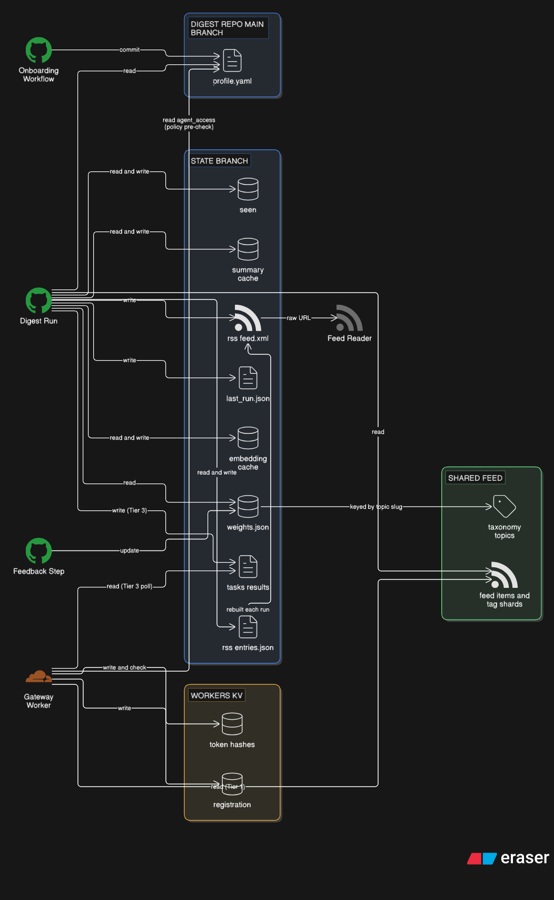
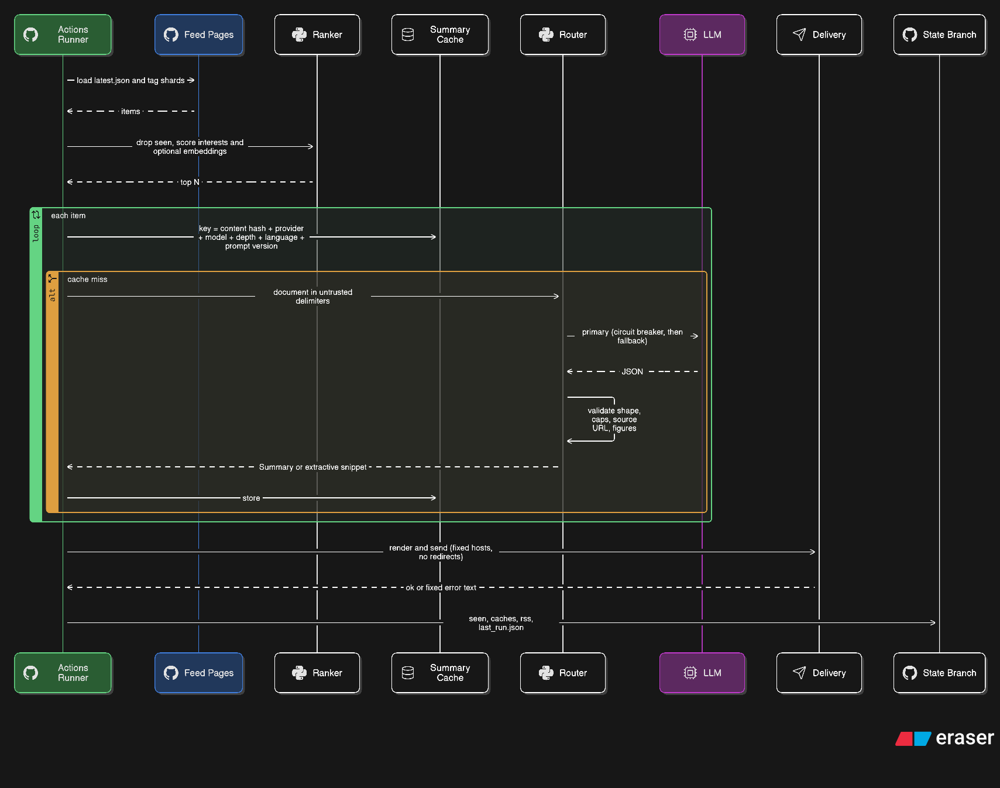
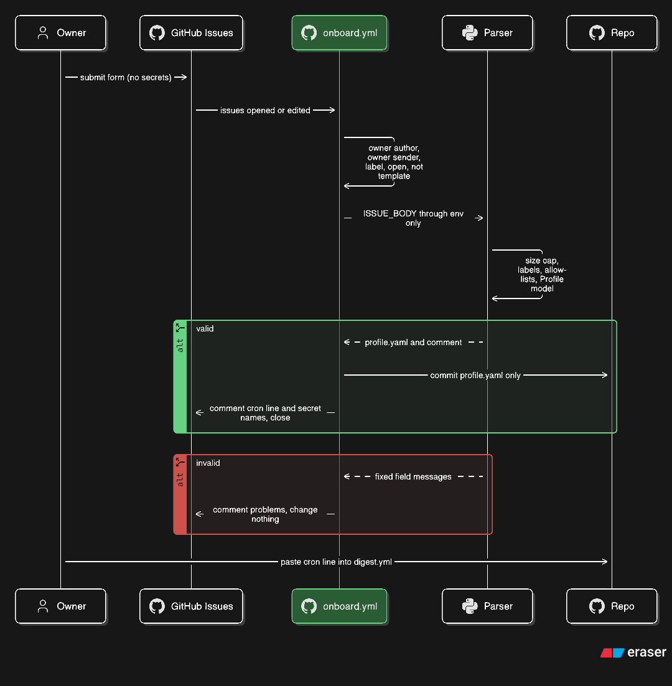
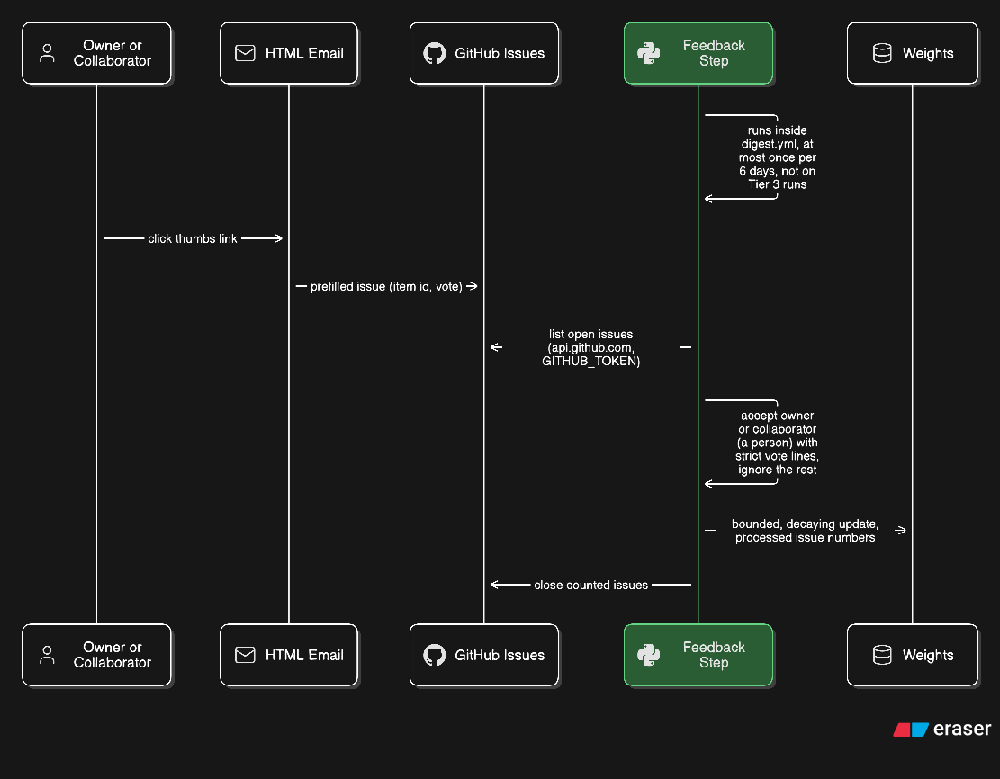
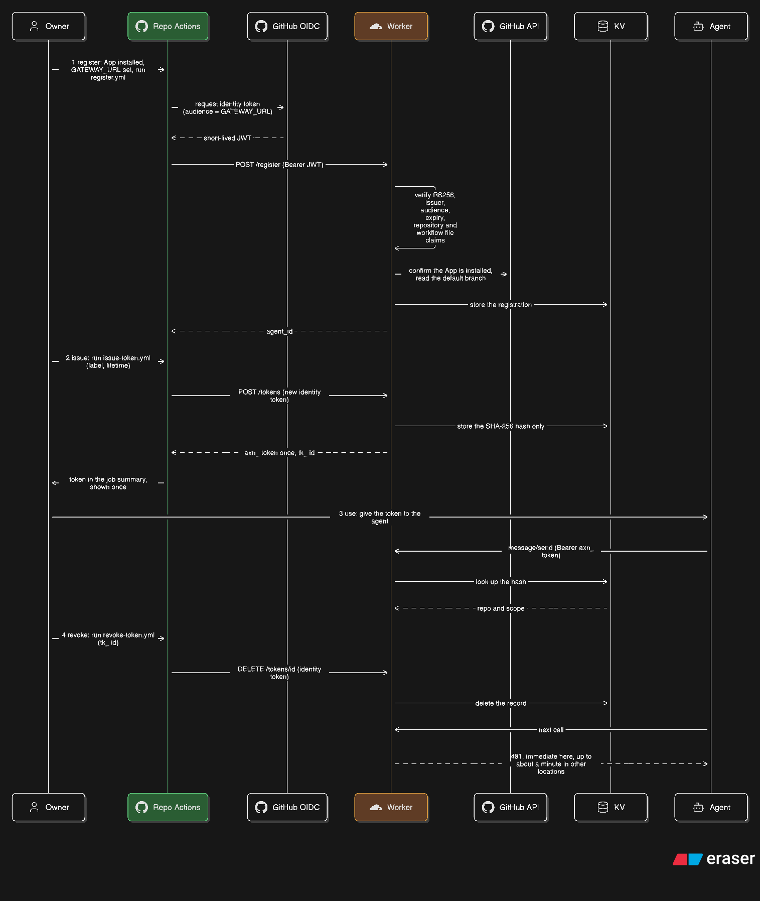
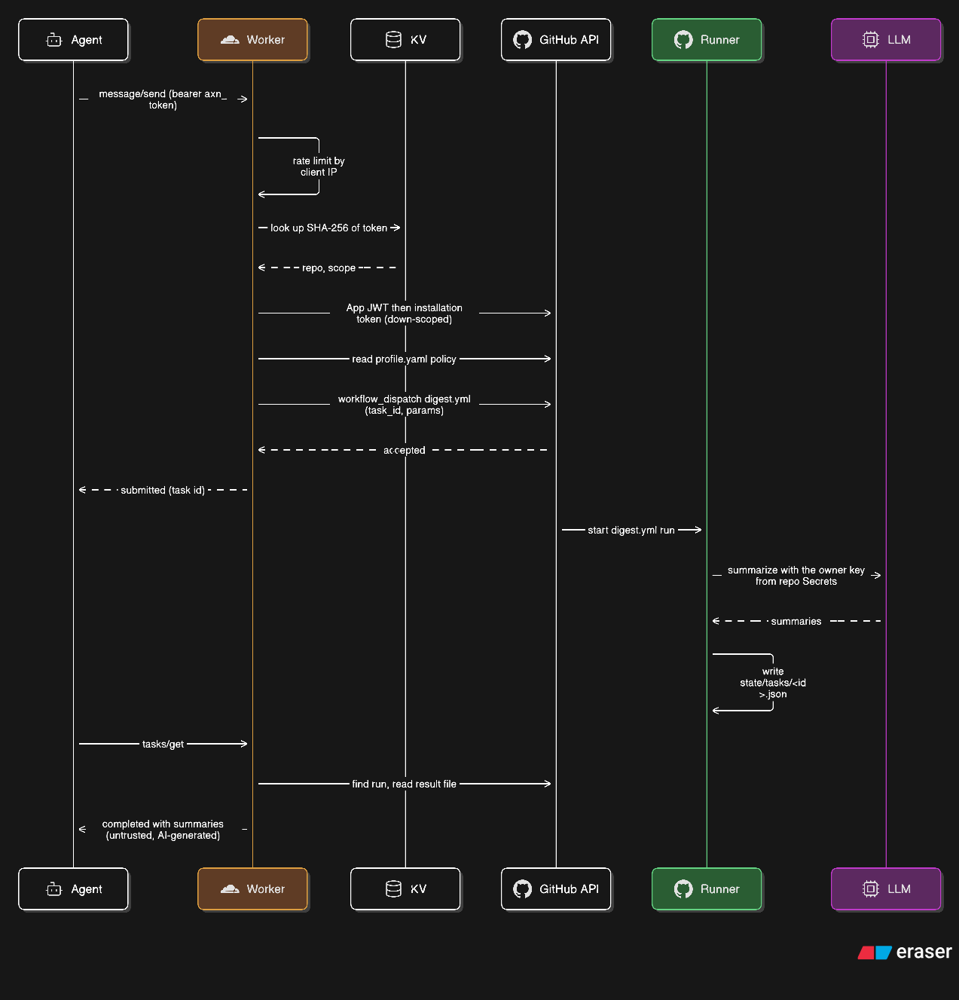

# axon-template architecture

`axon-template` is **plane 2** of [Axon](https://github.com/gowthamsai09/Axon): the per-user digest
pipeline. You create your own **private** repository from it ("Use this template", not a fork). A scheduled
GitHub Actions workflow reads the shared feed, ranks it by your interests, summarises the top items with
**your** LLM key and delivers the digest.

Spec sections: 4.2 and 6, plus Appendix C items 62 to 64, 76 to 87 and 88 to 127. Where this file and the
spec differ, the spec wins.


## What lives where

| Place | What |
|---|---|
| `main` branch of your private repo | Code, `profile.yaml`, workflows. `profile.yaml` is the only file you normally edit |
| Repo **secrets** | `LLM_API_KEY`, channel credentials (email, Telegram, Slack), optional `EMBED_API_KEY`, `LLM_API_KEY_FALLBACK` |
| Repo **variables** | `FEED_BASE`, optional `SMTP_HOST`, `SMTP_PORT`, `GATEWAY_URL` |
| Orphan `state` branch | Everything the pipeline remembers between runs (below) |



The `state` branch holds: `seen` and `delivered.json` (item id to `{at, tags}`, so a rerun does not repeat
items), summary and embedding caches (7 days for embeddings), `weights.json` (feedback), `rss/feed.xml` and
`rss/entries.json`, `tasks/<id>.json` (Tier 3 results, kept 7 days) and `last_run.json` (counts and usage
only, no content). It holds no address, key or chat id.

## One digest run



Flow in `digest/pipeline.py` and `digest/cli.py`:

1. **Load the feed** from `FEED_BASE` (SSRF-guarded fetch; shards and `latest.json`).
2. **Add your own sources** (`sources.extra_rss`), fetched through the same guard.
3. **Drop what you already received** (`seen`).
4. **Rank** with your profile.
5. **Fetch text** for the top N only.
6. **Summary cache lookup**, then **router**: primary provider, circuit breaker, fallback, extractive snippet.
7. **Validate** each summary and build a `Summary`.
8. **Render and deliver** through the chosen channel, then mark items seen and write `last_run.json`.

### Ranking

```
user_score = base_score
           + 0.50 * interest_match
           + w * semantic            (only if embeddings are enabled and worked)
           + 0.20 * feedback         (clamped sum of per-topic vote weights, -1..1)
           - 0.50 * exclusion_penalty
interest_match = 0.5 * topics + 0.3 * entities + 0.2 * keywords
```

Matching is case-insensitive and whole-token, with hyphens, spaces and underscores interchangeable.
Items from your own `extra_rss` feeds always qualify. If your profile has only exclusions, nothing is
filtered out. Both optional terms are 0 when their feature is off.

### Summariser router

```
primary ──ok──────────────────────────────> validated Summary
   │ fail x3 (circuit breaker trips)
   v
fallback provider (if configured) ──ok────> validated Summary
   │ fail
   v
extractive snippet (feed snippet, at most 300 chars) ──> labelled as not AI-written
```

Providers: DeepSeek, Hugging Face, or any OpenAI-compatible endpoint (`base_url` must be https and is
SSRF-guarded). Model names go only into the JSON body.

Cache key: `sha256(content_hash | provider | model | depth | language | prompt_version)`. The prompt
version is `p-56a22986b1`; changing the prompt changes every key.

### Validation (why you can trust a summary more than raw model text)

- Shape and length caps (one-liner 200 characters, key point 160); over-length output is retried or repaired.
- Only the **source URL** may appear as a link.
- Figures in the summary must appear in the source text.
- A model that flags suspected injection (`injection_flag`) gets a snippet, not a summary.
- Output containing your own key is rejected.
- Every item links to its source and names the model that wrote it.

An observed quirk: `deepseek-flash` often exceeds the length limits, so 10 items took 17 LLM calls. The
prompt is locked; cost stayed under 0.01 USD for two runs.

## Delivery channels

| Channel | Notes | State |
|---|---|---|
| `email` | SMTP; HTML and plain text; optional thumbs links | **Verified live** (Gmail, port 465) |
| `telegram` | Messages of at most 4000 UTF-16 units, one second apart; Markdown escaped | **Verified live** |
| `slack` | Incoming webhook; only `https://hooks.slack.com/services/T../B../..` accepted; text escaped; at most 3500 units per message | **Verified live** |
| `rss` | Atom file on the `state` branch (at most 50 entries) | **Verified live**; readable only with repo access |

Untrusted item text is escaped per channel, so an item cannot form `<!channel>`, a mention or a link.

## Onboarding



Three ways to produce `profile.yaml`:

1. **Issue form** (`onboard.yml`): owner-only and personal-account repos only. Parses the form strictly
   (`### label` headings, `_No response_`, `- [x]`, and the text `None` for an unset optional dropdown),
   commits `profile.yaml`, closes the Issue and replies with the cron line to paste (a workflow cannot edit
   workflow files). It never echoes what you typed.
2. **CLI:** `python -m digest.cli init`.
3. **Chat prompt** (spec 13.2): a prompt you give to any chat assistant; it equals the template and hub copies.

## Feedback (optional, off by default)



With `feedback.enabled: true`, the HTML email carries thumbs links that open a prefilled Issue
(`item:<16hex> vote:up|down`). Inside `digest.yml`, at most once per 6 days and never on Tier 3 runs, the
**Apply feedback votes** step reads open Issues from the **owner or a collaborator** (a person, not a bot),
counts strict vote lines only, closes the accepted Issues and moves per-topic weights by a small bounded
step that halves every 30 days. Verified live with two owner votes. Not verified: a stranger's vote being ignored, and
the effect of weights on a later ranking. Known limitation: a run that finds no votes still starts the 6-day
wait (workaround recorded in Appendix C 122; fix offered, not built).

## Tier 3: running on behalf of an agent





Three workflows manage identity; all are `workflow_dispatch` only, carry the template-repo guard, a
5-minute timeout, no secrets and no third-party actions. They are the **only** workflows with
`id-token: write`.

| Workflow | Purpose |
|---|---|
| `register.yml` | Requests GitHub's OIDC token (audience = your `GATEWAY_URL`) and calls the gateway `POST /register` |
| `issue-token.yml` | Asks the gateway for an owner token `axn_...`; the token appears **once** in the job summary, and only its SHA-256 is stored |
| `revoke-token.yml` | Revokes a token by its `tk_...` id |

When an agent starts a digest, the gateway dispatches `digest.yml` with two inputs, `task_id` and `params`.
The run's display title is `digest task <id>`, which is how the gateway finds the run. In Tier 3 mode the
pipeline:

- reads `agent_access` from `profile.yaml` (`allow_inbound_agents`, `allowed_modes` including `digest`,
  `max_tier3_runs_per_day`, `allow_owner_channel`) and refuses with an `owner_policy:` warning if the owner said no;
- ignores and never updates `seen` (an agent run does not use up your reading list);
- writes `state/tasks/<task_id>.json` with `completed` or `failed`; a refusal exits 0 so it surfaces as `rejected`;
- delivers through your channel only if `delivery: owner_channel` **and** `allow_owner_channel: true`.

## Workflows

| File | Trigger | Notes |
|---|---|---|
| `digest.yml` | cron (default `0 2 * * *` UTC = 07:30 IST), manual, Tier 3 dispatch | 20-minute timeout; `continue-on-error` state checkout; failure notice `if: failure()`; commit state `if: always()` |
| `onboard.yml` | Issues opened or edited with label `onboarding` | Owner only |
| `keepalive.yml` | monthly | Re-enables `digest`; a precaution (private repos are not auto-disabled) |
| `register.yml`, `issue-token.yml`, `revoke-token.yml` | manual | Tier 3 identity |
| `ci.yml` | push, PR | ruff, mypy, pytest |

Every acting workflow has least-privilege `permissions:`, inputs only through `env:`, third-party actions
pinned to commit SHAs and a guard so it does nothing inside the template repo itself.

## Security model

- Keys come from GitHub secrets, enter the process as environment variables and are redacted from logs,
  state and error messages. Error messages name a secret, never its value.
- All fetching uses the SSRF guard (`digest/safe_http.py`); provider hosts are fixed or validated.
- Untrusted text (feed items, model output, Issues, forms, inbound agent parameters) is never turned into
  commands, workflow inputs or URLs to fetch without validation.
- The summarizer prompt is byte-identical with the gateway and hub copies; the onboarding prompt equals
  the hub copy and the spec text.
- Tests: hostile corpora from the hub, injection and SSRF suites, and **95 mutation checks** that
  deliberately break a security rule to prove a test fails (94 observed on the maintainer's laptop, the
  95th derived).
- Fake secrets in tests are built by string concatenation so scanners do not flag them.

## Testing

```powershell
pip install -r requirements.txt -r requirements-dev.txt
ruff format .; ruff check .; mypy .; pytest
python -m evals.run replay        # offline check of the evaluation harness
```

Observed on the maintainer's Windows laptop (with the hub path set): 1400 collected, **1355 passed, 45
skipped** (44 need a POSIX bash and run in CI; 1 is an empty parameter set). Tests read a frozen baseline
profile, so editing your own `profile.yaml` does not break them.

## Known limitations

- A repo made from a template is a snapshot: later template fixes do not reach existing user repos.
  Copy changed files by hand.
- The onboarding form needs a personal-account repository.
- `evals live` (scoring the summariser on your model) is built but has not been run against a real model.
- Weekly trends and embeddings are mocked only.
